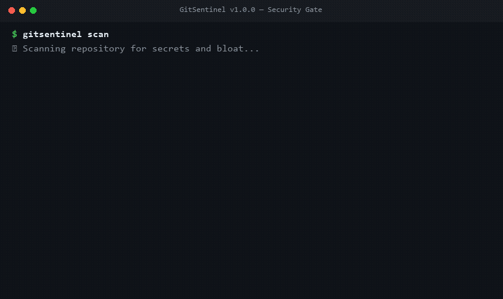

# 🛡️ GitSentinel

> **Autonomous Pre-Flight Security Scanner & AI Git Copilot for Developers**  
> *Catch secret leaks, eliminate repo bloat, and generate conventional commit messages before code leaves your machine.*

<div align="center">
  
</div>

---

## ⚡ Interactive Terminal Demo

```bash
$ gitsentinel scan
🔍 Scanning directory: C:\Projects\MyAgent

Found 3 item(s):
1. 🚨 CRITICAL [SECRET] in .env.local:1
   Dangerous sensitive file detected: '.env.local'. Must be added to .gitignore.

2. 🚨 CRITICAL [SECRET] in config.py:12
   Potential leak detected: OpenAI API Secret Key
   Snippet: OPENAI_API_KEY = "sk-a****9821"

3. ⚠️  HIGH [BLOAT] in __pycache__
   Untracked/staged bloat directory detected: '__pycache__'.

Summary: 2 critical, 1 non-critical.
❌ GitSentinel: Commit blocked. Fix reported leaks before pushing!

$ gitsentinel doctor
🩺 Diagnosing repository health...
Repository Health Score: 95/100 [✓ PASS]
[✓ PASS] Git Initialization
[✓ PASS] .gitignore Hygiene
[✓ PASS] Documentation & License
[✓ PASS] Tracked Blob Sizes (<10MB)

$ gitsentinel commit --hint "add multi-agent routing"
🤖 Synthesizing Conventional Commit Message...
Proposed Title: feat(agents): implement dynamic multi-agent task routing
Change Description:
  - Modified 3 files:
    * agents/router.py
    * tests/test_router.py
    * config.json
```

---

## ⚡ Why GitSentinel?

Every developer makes mistakes before pushing code:
- 🚨 **Accidental Secret Leaks:** Pushing `.env` files, API tokens (OpenAI, Gemini, AWS, Stripe), or SSH private keys.
- 🐘 **Repository Bloat:** Unintentionally tracking `node_modules`, `__pycache__`, or giant binary assets (>10MB).
- 🧩 **Dangerous Code Patterns:** Silent error masking (`except: pass`), `eval()` vulnerabilities, or missing `.gitignore` coverage.
- 📝 **Vague Commit Messages:** Committing with messages like `"update"`, `"fix"`, or `"done"` instead of standardized Conventional Commits.

**GitSentinel** solves this as a lightweight, zero-bloat CLI and git hook that guards your repository.

---

## 🚀 Key Capabilities

### 1. 🔍 Secret & Sensitive File Scanner
Scans your staged files or repository for high-entropy tokens and credentials:
- Google Gemini API Keys (`AIzaSy...`)
- OpenAI / Anthropic Keys (`sk-...`)
- AWS Access Keys (`AKIA...`)
- GitHub Personal Access Tokens (`ghp_...`, `github_pat_...`)
- Stripe / Slack / Cloud Secret assignments
- Private cryptographic keys (`.pem`, `id_rsa`)
- Unprotected `.env` environments

### 2. 🩺 Repository Health Doctor (`gitsentinel doctor`)
Runs a comprehensive diagnostic check:
- `.gitignore` completeness and rule hygiene
- Tracked blob sizes and bloat indicators
- Documentation (`README.md`) and licensing compliance
- Remote origin configuration and branch health
- Computes an actionable **Repository Health Score (0-100)**

### 3. 🤖 AI & Rule-Based Conventional Commit Synthesizer (`gitsentinel commit`)
Inspects your actual `git diff` and change status to synthesize professional Conventional Commit titles:
- Classifies changes as `feat`, `fix`, `docs`, `refactor`, `test`, or `chore`.
- Auto-infers the target module scope.
- Optional integration with **Google Gemini 2.5 Flash** for deep semantic summaries.

### 4. 🪝 One-Command Git Pre-Commit Hook (`gitsentinel install-hook`)
Installs a native `.git/hooks/pre-commit` script that automatically blocks any commit containing critical secrets.

---

## 📦 Installation & Quickstart

```bash
# Clone the repository
git clone https://github.com/Rishabhraj06/GitSentinel.git
cd GitSentinel

# Install locally in editable mode
pip install -e .
```

---

## 💻 Usage Commands

| Command | Action |
| :--- | :--- |
| `gitsentinel scan` | Scans working tree for API keys, passwords, and bloat |
| `gitsentinel scan --fail-on-critical` | Non-zero exit code if critical leaks found (CI/CD ready) |
| `gitsentinel doctor` | Evaluates repository hygiene and gives a 0-100 health score |
| `gitsentinel commit` | Analyzes diff and proposes conventional commit title & bullets |
| `gitsentinel commit --auto` | Automatically executes git commit with generated message |
| `gitsentinel install-hook` | Installs automatic pre-commit safety gate |

---

## 🧪 Verification & Unit Tests

GitSentinel comes with an automated Pytest test suite covering all security detectors, AST parsers, and diagnostic engines:

```bash
python -m pytest tests/ -v
# 9 passed in 0.38s (100% test pass rate)
```

---

## 👤 Author & Architecture

- **Author:** Rishabh Raj ([@Rishabhraj06](https://github.com/Rishabhraj06))
- **Architecture Tenet:** Minimal external dependencies, standard library first, zero bloat, high execution speed.
- **License:** MIT
